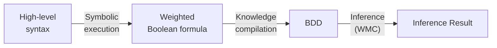

# CryptPP: Cryptography with Probabilistic Programming

## What is CryptPP?
CryptPP is a project that uses the probabilistic programming language (PPL) to analyze cryptographic proofs. The project has two parts: creating a PPL suited for cryptographic schemes and using [Roulette](https://docs.racket-lang.org/roulette/index.html) to model cryptographic schemes.

### Project Proposal
This project is for Programming with Probability (CS 4973), and you can access typed project proposal [here](Sunkwan_Kim___CS_4973_Project_Proposal.pdf).

## 1. Probabilistic Programming Language
### [Pipeline](pipeline.rkt)

*Inference via Weighted Model Counting Pipeline.*

## 2. Modeling Cryptographic Schemes
### Security Games 
#### [Semantic Security](semantic_security.rkt)
Semantic Security based on Dan Boneh and Victor Shoup's "A Graduate Course in Applied Cryptography" (2023)

### Protocols
#### [Reed-Solomon Fingerprinting Protocol](reed_solomon_fingerprinting.rkt)
Reed-Solomon Fingerprinting Protocol based on Justin Thaler's "Proofs, Arguments, and Zero-Knowledge" (2023)

### [Sum-Check Protocol](sum_check_protocol.rkt)
Sum-Check Protocol based on Justin Thaler's "Proofs, Arguments, and Zero-Knowledge" (2023)

## Proof Games
